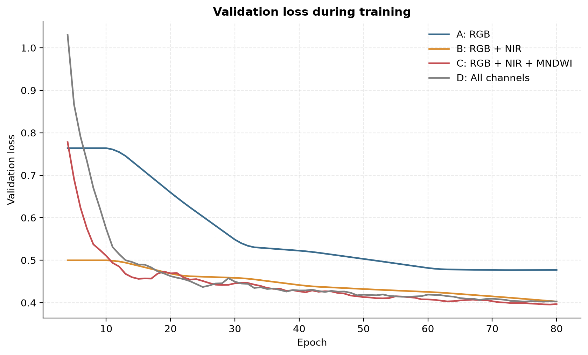
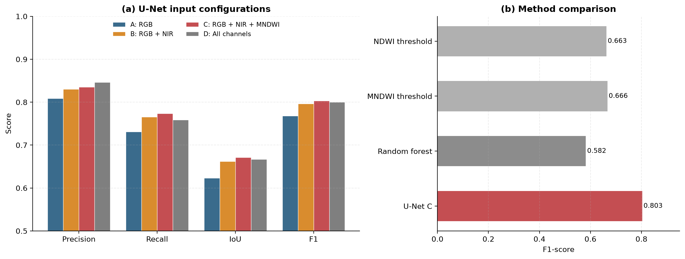
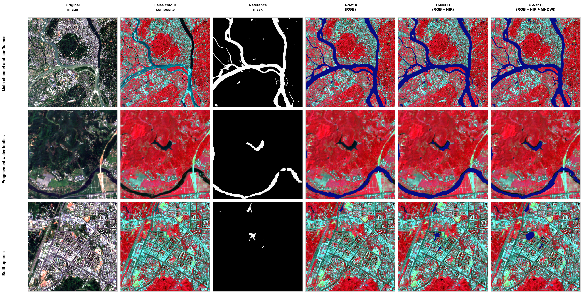

# Multimodal Water Body Semantic Segmentation with U-Net


Pixel-level surface water mapping from Sentinel-2 multispectral imagery. The
project benchmarks four spectral input configurations for a U-Net and compares
the network against water-index thresholding and a per-pixel random forest.

## Overview

Surface water is mapped over the confluence of the Min, Dadu and Qingyi rivers
near Leshan, Sichuan, China (103.40°E-104.10°E, 29.20°N-29.80°N). The data are
Sentinel-2 Level-2A surface reflectance acquired in August-September 2025 at
10 m resolution (UTM zone 48N), cloud-masked and mosaicked in Google Earth
Engine. Binary water masks from the JRC Global Surface Water dataset are used as
reference labels.


The main questions addressed:

- How much does near-infrared reflectance contribute to water segmentation?
- Does adding a water index (MNDWI, NDWI) improve a CNN that already sees the
  source bands?
- Are simple index-based post-processing steps able to refine network output?

## Input configurations

The image stack contains seven channels: `B2, B3, B4, B8, B11, NDWI, MNDWI`.
Four subsets are trained and evaluated with the same architecture and schedule.

| ID | Configuration | Channels | Count |
|----|---------------|----------|-------|
| A | RGB | B4, B3, B2 | 3 |
| B | RGB + NIR | B4, B3, B2, B8 | 4 |
| C | RGB + NIR + MNDWI | B4, B3, B2, B8, MNDWI | 5 |
| D | All channels | B4, B3, B2, B8, NDWI, MNDWI | 6 |

NDWI = (B3 - B8) / (B3 + B8) and MNDWI = (B3 - B11) / (B3 + B11).

## Method

- **Model**: four-level U-Net with 64, 128, 256 and 512 channels per encoder
  level and a 1024-channel bottleneck, about 31M parameters.
- **Loss**: binary cross-entropy plus soft Dice loss.
- **Optimiser**: AdamW, learning rate `1e-4`, weight decay `1e-4`.
- **Schedule**: `ReduceLROnPlateau` (factor 0.5, patience 5), early stopping
  after 10 epochs without validation improvement, 80 epochs maximum.
- **Augmentation**: random horizontal and vertical flips, additive noise
  (sigma = 0.02) on one randomly selected reflectance band.
- **Patches**: 256 x 256 pixels with 50% overlap; a random 70/15/15 split with
  seed 42. A contiguous spatial split is available as a stricter alternative.
- **Metrics**: accuracy, precision, recall, IoU and F1-score on the held-out
  test patches. Because water covers only about 3.5% of the test pixels,
  IoU and F1 are the primary indicators.

## Results

Test set: 344 patches, 3.49% water pixels. All numbers below are reproduced
by `src/evaluate.py` with the released checkpoints.

### U-Net input comparison

| Configuration | Accuracy | Precision | Recall | IoU | F1 |
|---------------|---------:|----------:|-------:|----:|---:|
| A: RGB | 0.9846 | 0.8085 | 0.7309 | 0.6230 | 0.7677 |
| B: RGB + NIR | 0.9864 | 0.8305 | 0.7653 | 0.6619 | 0.7965 |
| **C: RGB + NIR + MNDWI** | 0.9868 | 0.8351 | 0.7735 | **0.6710** | **0.8031** |
| D: All channels | **0.9868** | **0.8466** | 0.7588 | 0.6671 | 0.8003 |

### Comparison with baselines

| Method | Accuracy | Precision | Recall | IoU | F1 |
|--------|---------:|----------:|-------:|----:|---:|
| NDWI threshold (T = 0.10) | 0.9802 | 0.8154 | 0.5584 | 0.4957 | 0.6628 |
| MNDWI threshold (T = 0.05) | 0.9806 | 0.8317 | 0.5561 | 0.4998 | 0.6665 |
| Random forest (RGB + NIR) | 0.9642 | 0.4914 | 0.7136 | 0.4104 | 0.5820 |
| U-Net C (RGB + NIR + MNDWI) | **0.9868** | **0.8351** | **0.7735** | **0.6710** | **0.8031** |

Index thresholds were tuned on the validation split and applied unchanged to
the test split. The random forest uses the same input patches and is trained on
200,000 stratified pixels from the training and validation splits.

### Post-processing

Applied to the probabilities of configuration C.

| Variant | Accuracy | Precision | Recall | IoU | F1 |
|---------|---------:|----------:|-------:|----:|---:|
| No post-processing | 0.9868 | 0.8351 | 0.7735 | 0.6710 | 0.8031 |
| MNDWI threshold filtering | 0.9825 | **0.9199** | 0.5455 | 0.5207 | 0.6848 |
| Probability fusion (alpha = 0.7) | 0.9868 | 0.8383 | 0.7712 | 0.6713 | 0.8034 |
| Confidence-guided refinement | **0.9869** | 0.8404 | 0.7694 | **0.6714** | **0.8034** |

### Key observations

- NIR is the single most useful addition to RGB: F1 rises from 0.7677 to 0.7965
  and IoU from 0.6230 to 0.6619.
- Adding MNDWI on top of RGB + NIR gives the best overall segmentation
  (F1 0.8031, IoU 0.6710), while the full stack reaches the highest precision.
- Adding NDWI alongside MNDWI (configuration D) does not improve over C,
  suggesting that the two indices are largely redundant for this network.
- The U-Net clearly outperforms both index thresholding and the random forest.
  The random forest has high recall but low precision, which is consistent with
  pixel-wise spectral confusion between water, shadow and dark surfaces.
- Threshold filtering of the network output raises precision to 0.92 but removes
  a large share of water pixels. Probability fusion and confidence-guided
  refinement only bring marginal gains.

## Figures

### Validation loss



### Input configuration and baseline comparison



### Qualitative examples

From left to right: RGB image, JRC reference mask, and predictions from
configurations A, B and C.



## Repository structure

```
.
├── data/
│   └── README.md                  # expected raw and processed files
├── docs/figures/                  # figures used in this README
├── gee/water_extraction.js        # Earth Engine export script
├── results/                       # metric tables and training history
├── src/
│   ├── baselines/
│   │   ├── random_forest.py       # per-pixel random forest baseline
│   │   └── spectral_index.py      # NDWI / MNDWI threshold baseline
│   ├── figures/
│   │   ├── model_comparison.py
│   │   ├── qualitative_examples.py
│   │   └── training_curves.py
│   ├── build_dataset.py           # patch extraction and train/val/test split
│   ├── evaluate.py                # metrics and post-processing
│   ├── infer.py                   # full-scene sliding-window inference
│   ├── metrics.py                 # shared metric functions
│   ├── schemes.py                 # band layout and input configurations
│   ├── train.py                   # training loop
│   └── unet.py                    # U-Net definition
├── .gitignore
├── requirements.txt
└── README.md
```

## Getting started

```bash
git clone https://github.com/zhengjiabei1/Multimodal-Water-Body-Semantic-Segmentation-with-U-Net.git
cd Multimodal-Water-Body-Semantic-Segmentation-with-U-Net

python -m venv .venv
source .venv/bin/activate
pip install -r requirements.txt
```

PyTorch is selected automatically (`cuda`, then `mps`, then `cpu`). Pass
`--device` to override it.

### Pretrained checkpoints

The four trained models are available in the
[v1.0.0 release](https://github.com/zhengjiabei1/Multimodal-Water-Body-Semantic-Segmentation-with-U-Net/releases/tag/v1.0.0).
Download them into `checkpoints/`:

```
checkpoints/unet_A.pth   # RGB
checkpoints/unet_B.pth   # RGB + NIR
checkpoints/unet_C.pth   # RGB + NIR + MNDWI (best F1 and IoU)
checkpoints/unet_D.pth   # all channels
```

Each file contains the model state dict. The input configuration is recovered
automatically from the tensor shapes during inference, or can be supplied with
`--scheme`.

### 1. Prepare the data

Run `gee/water_extraction.js` in the Earth Engine Code Editor and start the
three export tasks. Place the downloaded rasters in `data/raw/`:

```
data/raw/Leshan_AllBands.tif
data/raw/Leshan_RGB.tif
data/raw/Leshan_JRC_WaterLabel.tif
```

Then build the patch archive:

```bash
python src/build_dataset.py \
  --image data/raw/Leshan_AllBands.tif \
  --label data/raw/Leshan_JRC_WaterLabel.tif \
  --output data/processed/water_dataset.npz
```

Add `--split spatial` for the contiguous spatial split instead of the random
patch split.

### 2. Train

```bash
python src/train.py --scheme C
```

Checkpoints are written to `checkpoints/unet_C.pth` and the loss history is
merged into `results/training_history.json`. Train the other configurations
with `--scheme A`, `--scheme B` or `--scheme D`.

### 3. Evaluate

```bash
python src/evaluate.py --schemes A B C D
```

This writes `results/model_comparison.json` and `results/postprocessing.json`.

### 4. Run baselines

```bash
python src/baselines/spectral_index.py
python src/baselines/random_forest.py
```

### 5. Full-scene inference

```bash
python src/infer.py \
  --image data/raw/Leshan_AllBands.tif \
  --checkpoint checkpoints/unet_C.pth \
  --output-dir outputs
```

The script uses overlapping tiles and averages predictions to avoid seam
artefacts. It writes a probability map and a binary water mask as GeoTIFF.

### 6. Regenerate the figures

```bash
python src/figures/training_curves.py
python src/figures/model_comparison.py
python src/figures/qualitative_examples.py \
  --image data/raw/Leshan_RGB.tif \
  --label data/raw/Leshan_JRC_WaterLabel.tif \
  --predictions outputs
```

## Data notes

- Raw imagery is not committed because of its size. The trained checkpoints are
  distributed through the v1.0.0 release rather than the Git history; each one
  is about 124 MB.
- The reference mask is the JRC Global Surface Water `max_extent` layer, which
  represents the maximum observed water extent. It is not acquired on the same
  date as the Sentinel-2 image, so seasonal water and small water bodies may be
  labelled inconsistently.
- The JRC layer is distributed at 30 m and resampled to the 10 m Sentinel-2
  grid, which introduces boundary uncertainty.
- A random patch split shares spatial context between subsets. The `spatial`
  option in `build_dataset.py` provides a stricter evaluation for studies that
  require spatially independent test data.

## References

- Sentinel-2 Level-2A: <https://developers.google.com/earth-engine/datasets/catalog/COPERNICUS_S2_SR_HARMONIZED>
- JRC Global Surface Water: <https://developers.google.com/earth-engine/datasets/catalog/JRC_GSW1_4_GlobalSurfaceWater>
- U-Net: Ronneberger, Fischer and Brox, *U-Net: Convolutional Networks for
  Biomedical Image Segmentation*, MICCAI 2015.
- NDWI: McFeeters, *The use of the Normalized Difference Water Index (NDWI) in
  the delineation of open water features*, 1996.
- MNDWI: Xu, *Modification of normalised difference water index (NDWI) to
  enhance open water features in remotely sensed imagery*, 2006.
