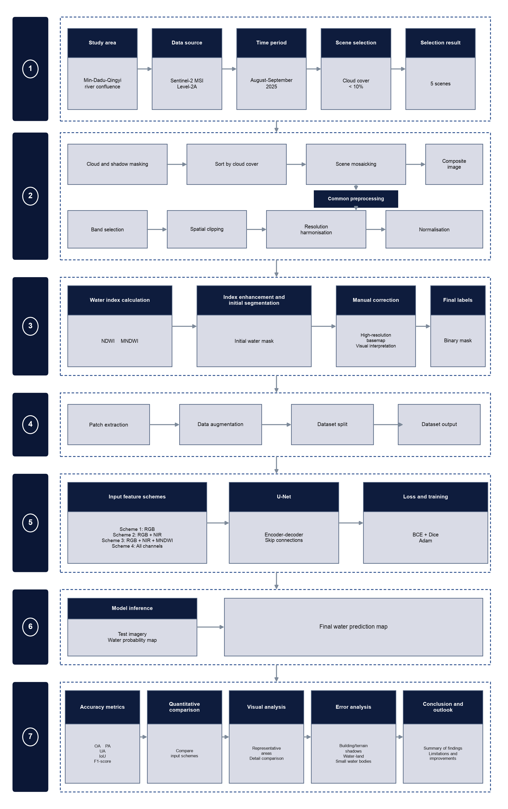
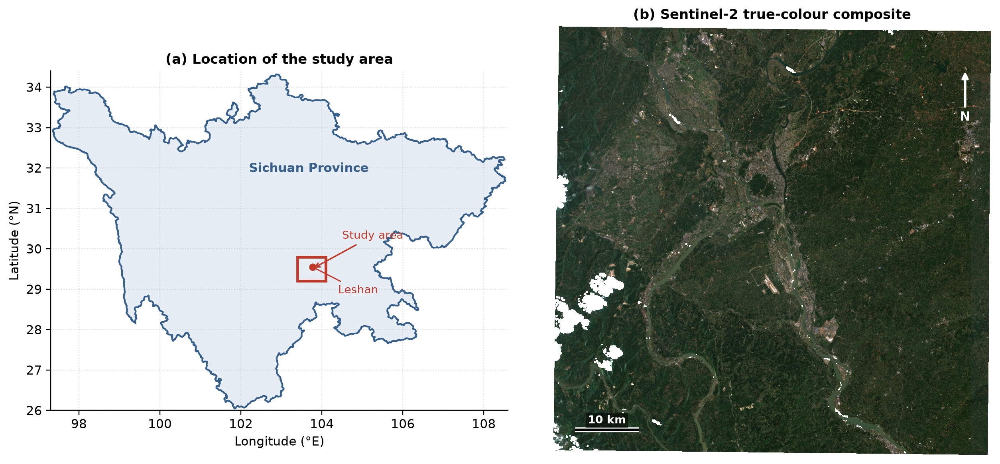
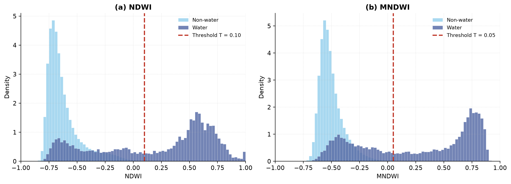
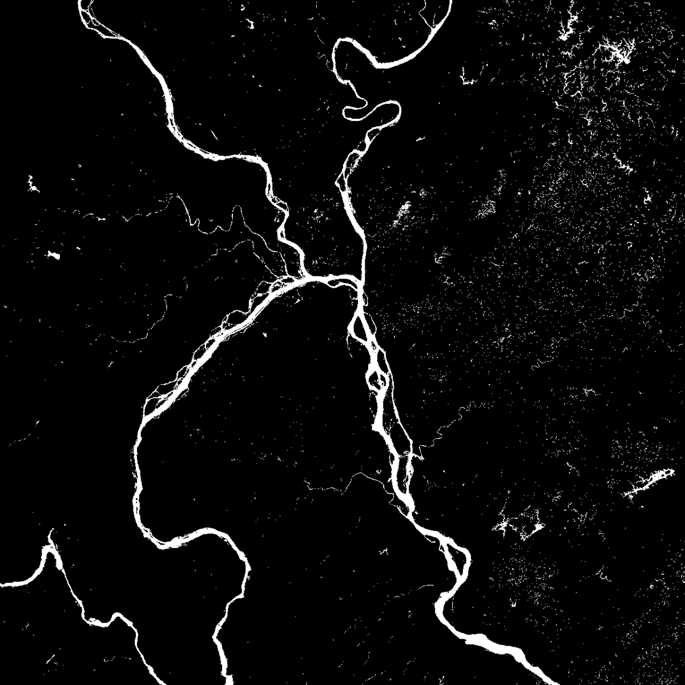
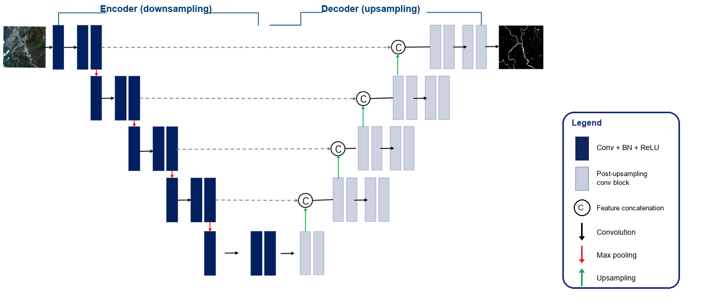

# Multimodal Water Body Semantic Segmentation with U-Net


Pixel-level surface water mapping from Sentinel-2 multispectral imagery. The
project compares four spectral input configurations for a U-Net and analyses
how near-infrared reflectance and water indices affect water identification in
a complex river confluence area.

## Overview

Accurate surface water maps support flood monitoring, water resource
management and ecological assessment. In optical imagery, water is easily
confused with building shadows, terrain shadows and dark surfaces, while mixed
pixels along river banks and mudflats make water-land boundaries difficult to
delineate. This project addresses these issues by combining spectral water
indices with a U-Net semantic segmentation model.

The study area covers the confluence of the Min, Dadu and Qingyi rivers around
Leshan, Sichuan, China. Sentinel-2 Level-2A imagery from August-September 2025
is cloud-masked and mosaicked, and four input schemes are trained and evaluated
on the same data split:

- RGB,
- RGB + NIR,
- RGB + NIR + MNDWI,
- RGB + NIR + NDWI + MNDWI.

Key findings:

- NIR is the single most valuable addition to RGB. IoU rises from 0.6230 to
  0.6619 and F1 from 0.7677 to 0.7965.
- Adding MNDWI on top of RGB + NIR gives the best overall result: IoU 0.6710,
  F1 0.8031, Kappa 0.7963.
- Adding NDWI together with MNDWI does not improve accuracy (IoU 0.6671,
  F1 0.8003). The two indices are highly redundant and the extra channel can
  encourage slight overfitting.
- MNDWI reduces false positives caused by building shadows, while NIR improves
  the detection of fragmented and narrow water bodies.

## Workflow

The overall technical route is summarised below: imagery selection and
preprocessing, water index calculation and label preparation, dataset
construction, U-Net training with four input configurations, inference, and
accuracy and error analysis.



## Study area

The study area is located at the southwestern margin of the Sichuan Basin,
spanning parts of Leshan, Meishan and Zigong, with an area of about
3,200 km². The Min River runs through the region from north to south, while the
Dadu and Qingyi rivers enter from the southwest and northwest. The resulting
dense river network includes large channels, tributaries, reservoirs and small
ponds.

The region has a subtropical humid monsoon climate with annual precipitation of
about 1,000-1,400 mm. The wet season peaks in July-August, and water levels
remain relatively high in August-September, which makes water boundaries clear
and stable. Imagery from this period is also less cloudy than July. Terrain
drops from the Emei Mountains in the west to the Sichuan Basin in the east,
producing frequent mountain shadows that complicate water extraction.



## Data

### Sentinel-2 imagery

Sentinel-2 Level-2A surface reflectance is used because atmospheric correction
has already been applied. Five scenes with cloud cover below 10% were selected
for August-September 2025. The mosaic is gridded at 10 m in EPSG:32648
(UTM zone 48N); the 20 m short-wave infrared band B11 is resampled to 10 m with
bilinear interpolation before index calculation.

| Band | Name | Native resolution | Role |
|------|------|-------------------|------|
| B2 | Blue | 10 m | RGB composites and visual interpretation |
| B3 | Green | 10 m | Key band for NDWI and MNDWI |
| B4 | Red | 10 m | True colour and false colour composites |
| B8 | Near-infrared | 10 m | Strong water absorption; NDWI and false colour |
| B11 | Short-wave infrared 1 | 20 m | MNDWI; suppresses built-up and soil noise |
| SCL / QA60 | Quality layers | 20 m | Cloud, cloud shadow and cirrus masking |

### Preprocessing

1. Mask clouds and cloud shadows in every scene with QA60 (dense cloud and
   cirrus bits) and SCL (cloud shadow, medium/high-probability cloud and
   cirrus classes).
2. Sort the masked scenes by cloud cover and mosaic them so that clearer
   observations fill gaps left by clouds in individual scenes.
3. Crop to the study area, align all bands to a common grid, and scale surface
   reflectance to the range 0-1.


### Water indices

NDWI uses the green and near-infrared bands:

```
NDWI = (B3 - B8) / (B3 + B8)
```

MNDWI replaces NIR with short-wave infrared:

```
MNDWI = (B3 - B11) / (B3 + B11)
```

Both indices enhance water against vegetation, soil and built-up surfaces while
reducing radiometric differences between scenes. The histograms below show the
class separability of the two indices and the thresholds used for the index
baselines in this repository.



### Reference labels

The binary reference masks follow the label preparation workflow: an initial
water extent is generated from the water-index maps and the JRC Global Surface
Water maximum-extent layer, then inspected and corrected in QGIS against the
original Sentinel-2 imagery and high-resolution basemaps. Water pixels are
encoded as 1 and non-water pixels as 0. Cloud, cloud-shadow and no-data pixels
are excluded from training and evaluation.



The white areas in the mask above indicate water. Because the initial extent is
based on the JRC maximum water extent, it is not perfectly date-matched to the
Sentinel-2 acquisition; manual quality control reduces, but does not fully
remove, this limitation.

### Patch dataset

The image stack and labels are cut into 256 x 256 patches with a stride of 128
pixels (50% overlap). Patches containing invalid pixels are discarded, and the
remaining patches are shuffled and split into 70% training, 15% validation and
15% test sets. Water covers about 3.3% of the training patches and 3.5% of the
test patches.

| Item | Setting | Purpose |
|------|---------|---------|
| Patch size | 256 x 256 pixels | Context and training efficiency |
| Stride | 128 pixels | 50% overlap, reduces edge effects |
| Training set | 70% | Parameter learning |
| Validation set | 15% | Model selection and early stopping |
| Test set | 15% | Final evaluation |
| Geometric augmentation | Flips and 90° rotations | Robustness to orientation |
| Spectral augmentation | Brightness jitter and Gaussian noise | Robustness to illumination and sensor noise |

## Model

### Input configurations

The seven-channel stack is `B2, B3, B4, B8, B11, NDWI, MNDWI`. Four subsets are
trained with the same architecture and schedule.

| ID | Configuration | Channels | Count | Purpose |
|----|---------------|----------|-------|---------|
| A | RGB | B4, B3, B2 | 3 | Baseline with visible light only |
| B | RGB + NIR | B4, B3, B2, B8 | 4 | Contribution of near-infrared |
| C | RGB + NIR + MNDWI | B4, B3, B2, B8, MNDWI | 5 | Effect of a water index prior |
| D | RGB + NIR + NDWI + MNDWI | B4, B3, B2, B8, NDWI, MNDWI | 6 | Multi-index fusion |

### U-Net architecture

A standard four-level U-Net is used. Each encoder level applies two 3 x 3
convolutions with batch normalization and ReLU, followed by 2 x 2 max pooling.
The encoder widths are 64, 128, 256 and 512, and the bottleneck contains 1024
channels. The decoder uses transposed convolutions for 2x upsampling, concatenates
the corresponding encoder features through skip connections, and refines them
with two 3 x 3 convolutions. If an upsampled feature map and its skip connection
differ in size, bilinear interpolation aligns them before concatenation. A 1 x 1
convolution and a sigmoid produce a single-channel water probability map; pixels
above 0.5 are classified as water. The model has about 31M parameters.



The four-level design is a compromise between receptive field and detail. A
256 x 256 input becomes 16 x 16 at the bottleneck, where each pixel already has
a receptive field covering the whole input, which is useful for large rivers and
reservoirs. Deeper networks would compress spatial information too aggressively
for boundary recovery, while shallower networks would limit high-level context.

### Loss function

Water pixels are a small minority, so the model is trained with a combination of
binary cross-entropy and soft Dice loss:

```
L = BCE(p, y) + DiceLoss(p, y)
```

```
DiceLoss = 1 - (2 * sum(p_i * y_i) + epsilon) / (sum(p_i) + sum(y_i) + epsilon)
```

Here `p_i` is the predicted water probability, `y_i` is the reference label and
`epsilon = 1e-6`. Dice loss addresses class imbalance, while BCE provides stable
pixel-wise gradients.

### Training strategy

- Optimiser: AdamW (Adam with decoupled weight decay), learning rate `1e-4`,
  weight decay `1e-4`.
- Batch size: 8.
- Schedule: `ReduceLROnPlateau` with factor 0.5 and patience 5.
- Early stopping: patience 10 epochs. It was enabled but not triggered in the
  reported runs; all four models trained for 80 epochs.
- Gradient clipping: maximum norm 1.0.
- Augmentation: horizontal and vertical flips, 90° rotations, brightness jitter
  and Gaussian noise on the reflectance bands.
- Hardware: the reported runs were performed with PyTorch on Apple Silicon
  (MPS); the code also runs on CUDA and CPU.

## Evaluation metrics

Water is treated as the positive class. TP, FP, FN and TN are obtained from the
confusion matrix:

| Metric | Definition |
|--------|------------|
| Accuracy | (TP + TN) / (TP + TN + FP + FN) |
| Precision | TP / (TP + FP) |
| Recall | TP / (TP + FN) |
| IoU | TP / (TP + FP + FN) |
| F1 | 2 x Precision x Recall / (Precision + Recall) |
| Kappa | (p_o - p_e) / (1 - p_e) |

For Kappa, `p_o` is the observed agreement (Accuracy) and `p_e` is the agreement
expected by chance from the row and column marginals. Accuracy is high even for
weak models because non-water dominates the test set; IoU, F1 and Kappa are
therefore the primary indicators.

## Results

Test set: 344 patches, 3.49% water pixels. All numbers are reproduced by
`src/evaluate.py` with the released checkpoints.

### Input configuration comparison

| Configuration | Accuracy | Precision | Recall | IoU | F1 | Kappa |
|---------------|---------:|----------:|-------:|----:|---:|------:|
| A: RGB | 0.9846 | 0.8085 | 0.7309 | 0.6230 | 0.7677 | 0.7598 |
| B: RGB + NIR | 0.9864 | 0.8305 | 0.7653 | 0.6619 | 0.7965 | 0.7895 |
| **C: RGB + NIR + MNDWI** | 0.9868 | 0.8351 | 0.7735 | **0.6710** | **0.8031** | **0.7963** |
| D: All channels | **0.9868** | **0.8466** | 0.7588 | 0.6671 | 0.8003 | 0.7935 |

All four configurations maintain high overall accuracy, but IoU and F1 first
rise and then flatten as more channels are added. The gains are not linear, and
precision and recall trade off between configurations.

- **A (RGB)** already provides a solid baseline: IoU 0.6230 and F1 0.7677. With
  sufficient training samples, visible texture and colour support basic water
  recognition.
- **B (RGB + NIR)** is the largest single improvement. Recall increases from
  0.7309 to 0.7653, IoU from 0.6230 to 0.6619 and F1 from 0.7677 to 0.7965.
  Vegetation is highly reflective in NIR while water absorbs it, so NIR helps
  separate water from vegetated backgrounds.
- **C (RGB + NIR + MNDWI)** gives the best overall segmentation. MNDWI raises
  precision from 0.8305 to 0.8351, IoU to 0.6710 and F1 to 0.8031. The index
  provides a physically meaningful water prior that suppresses false positives
  from built-up surfaces and shadows.
- **D (All channels)** reaches the highest precision (0.8466) but loses recall
  (0.7588). IoU and F1 fall slightly below C. NDWI and MNDWI are both built from
  the green band and are highly correlated; the extra channel adds redundancy,
  and with a limited sample size it can encourage mild overfitting.


## Qualitative results

The panels show three representative areas: the main channel and river
confluence, fragmented water bodies, and a built-up area with strong shadows.
Columns are the original image, the false colour composite (B8/B4/B3), the
reference mask (white = water) and the predictions of configurations A, B and C
(blue overlay).


- **Main channel and confluence.** All configurations capture the main channel
  with clear and continuous boundaries. Differences are small, which also
  indicates that the reference masks are of reasonable quality.
- **Fragmented water bodies.** RGB misses some small and shallow water bodies.
  NIR improves their detection, and MNDWI gives the best connectivity and
  boundary completeness among the three configurations.
- **Built-up area.** All models produce some false positives on building
  shadows. The error becomes more pronounced after adding NIR, because shadows
  are also dark in the near-infrared. MNDWI reduces the false positives but does
  not eliminate them. In mixed-pixel areas along water boundaries, the predicted
  edges remain slightly blurred.

## Error analysis

| Error type | Manifestation | Main cause | Possible improvement |
|------------|---------------|------------|----------------------|
| Shadow false positives | Building or terrain shadows classified as water | Low reflectance similar to water | MNDWI, DEM or shadow masks |
| Water / mudflat confusion | Wet soil classified as water | High moisture, index values close to water | More water samples and refined classes |
| Narrow channel omission | Rivers broken or discontinuous | Limited spatial resolution and few small-water samples | More small-water samples or higher-resolution imagery |
| Boundary offset | Predicted boundaries expand or shrink | Mixed pixels and label uncertainty | Better labels, boundary-aware loss, post-processing |
| Turbid water omission | Turbid or algae-rich water missed | Sediment and algae alter spectral response | Multi-temporal samples and adaptive thresholds |

Errors originate from three sources:

- **Data.** Residual thin clouds, cloud edges and sensor noise cause isolated
  false predictions. At 10 m resolution, narrow channels and bank pixels are
  mixed pixels containing water, vegetation and bare soil, so pixel-level
  agreement with the reference is difficult.
- **Labels.** The reference masks are affected by manual interpretation and by
  the mismatch between the JRC maximum extent and the acquisition date. Water
  covers only about 3.3% of the samples, so class imbalance still constrains the
  balance between precision and recall.
- **Model.** U-Net generalises less well to land-cover types that are rare in the
  training set. The drop from C to D indicates that extra, correlated input
  channels can cause feature redundancy and mild overfitting under a limited
  sample budget.

## Conclusion

- NDWI and MNDWI enhance water using the reflectance difference between green,
  near-infrared and short-wave infrared bands. They are simple and interpretable,
  and MNDWI is more effective in built-up and complex surface environments.
- Combining RGB, NIR and MNDWI embeds a physical water prior into the deep
  model. The ablation confirms that NIR contributes the largest single gain
  (IoU 0.6230 to 0.6619), while MNDWI further raises IoU to 0.6710 and F1 to
  0.8031.
- Using NDWI and MNDWI together does not improve accuracy. IoU is 0.6671 and F1
  0.8003, close to but below configuration C, which confirms the redundancy
  between the two indices.

## Future work

- Add multi-temporal and multi-region samples to improve generalisation across
  surface backgrounds and water-level conditions.
- Introduce boundary-aware losses, attention mechanisms and multi-scale feature
  fusion to improve narrow channels and water-land boundaries.
- Fuse Sentinel-1 SAR data with Sentinel-2 optical imagery to exploit
  all-weather observation and improve performance under cloud cover.
- Explore larger and more balanced training sets, and evaluate the model on
  independent regions rather than a random patch split alone.

## Supplementary experiments

The repository also includes two baselines and three post-processing variants.
They are not part of the four-scheme ablation above but provide context for the
segmentation results.

| Method | Accuracy | Precision | Recall | IoU | F1 | Kappa |
|--------|---------:|----------:|-------:|----:|---:|------:|
| NDWI threshold (T = 0.10) | 0.9802 | 0.8154 | 0.5584 | 0.4957 | 0.6628 | 0.6530 |
| MNDWI threshold (T = 0.05) | 0.9806 | 0.8317 | 0.5561 | 0.4998 | 0.6665 | 0.6569 |
| Random forest (RGB + NIR) | 0.9445 | 0.3592 | 0.7544 | 0.3216 | 0.4867 | 0.4612 |
| U-Net C (RGB + NIR + MNDWI) | **0.9868** | **0.8351** | **0.7735** | **0.6710** | **0.8031** | **0.7963** |

Index thresholds are tuned on the validation split and applied unchanged to the
test split. The random forest is trained on 200,000 stratified pixels from the
training and validation splits. Its high recall and low precision indicate that
pixel-wise spectral classification confuses water with shadows and dark
surfaces, while the U-Net exploits spatial context.

Post-processing applied to the probabilities of configuration C:

| Variant | Accuracy | Precision | Recall | IoU | F1 | Kappa |
|---------|---------:|----------:|-------:|----:|---:|------:|
| No post-processing | 0.9868 | 0.8351 | 0.7735 | 0.6710 | 0.8031 | 0.7963 |
| MNDWI threshold filtering | 0.9825 | **0.9199** | 0.5455 | 0.5207 | 0.6848 | 0.6764 |
| Probability fusion (alpha = 0.7) | 0.9868 | 0.8383 | 0.7712 | 0.6713 | 0.8034 | 0.7966 |
| Confidence-guided refinement | **0.9869** | 0.8404 | 0.7694 | **0.6714** | **0.8034** | **0.7966** |

Threshold filtering raises precision to 0.92 but removes many water pixels.
Probability fusion and confidence-guided refinement bring only marginal gains.

## Repository structure

```
.
├── data/
│   └── README.md                  # expected raw and processed files
├── docs/figures/                  # figures used in this README
├── gee/water_extraction.js        # Earth Engine export script
├── results/                       # metric tables and training history
├── src/
│   ├── baselines/
│   │   ├── random_forest.py       # per-pixel random forest baseline
│   │   └── spectral_index.py      # NDWI / MNDWI threshold baseline
│   ├── figures/
│   │   ├── model_comparison.py
│   │   ├── qualitative_examples.py
│   │   ├── technical_route.py
│   │   └── training_curves.py
│   ├── build_dataset.py           # patch extraction and train/val/test split
│   ├── evaluate.py                # metrics and post-processing
│   ├── infer.py                   # full-scene sliding-window inference
│   ├── metrics.py                 # shared metric functions
│   ├── schemes.py                 # band layout and input configurations
│   ├── train.py                   # training loop
│   └── unet.py                    # U-Net definition
├── .gitignore
├── requirements.txt
└── README.md
```

## Getting started

```bash
git clone https://github.com/zhengjiabei1/Multimodal-Water-Body-Semantic-Segmentation-with-U-Net.git
cd Multimodal-Water-Body-Semantic-Segmentation-with-U-Net

python -m venv .venv
source .venv/bin/activate
pip install -r requirements.txt
```

PyTorch is selected automatically (`cuda`, then `mps`, then `cpu`). Pass
`--device` to override it.

### Pretrained checkpoints

The four trained models are available in the
[v1.0.0 release](https://github.com/zhengjiabei1/Multimodal-Water-Body-Semantic-Segmentation-with-U-Net/releases/tag/v1.0.0).
Download them into `checkpoints/`:

```
checkpoints/unet_A.pth   # RGB
checkpoints/unet_B.pth   # RGB + NIR
checkpoints/unet_C.pth   # RGB + NIR + MNDWI (best F1 and IoU)
checkpoints/unet_D.pth   # all channels
```

Each file contains the model state dict. The input configuration is recovered
automatically from the tensor shapes during inference, or can be supplied with
`--scheme`.

### 1. Prepare the data

Run `gee/water_extraction.js` in the Earth Engine Code Editor and start the
three export tasks. Place the downloaded rasters in `data/raw/`:

```
data/raw/Leshan_AllBands.tif
data/raw/Leshan_RGB.tif
data/raw/Leshan_JRC_WaterLabel.tif
```

Then build the patch archive:

```bash
python src/build_dataset.py \
  --image data/raw/Leshan_AllBands.tif \
  --label data/raw/Leshan_JRC_WaterLabel.tif \
  --output data/processed/water_dataset.npz
```

Add `--split spatial` for the contiguous spatial split instead of the random
patch split.

### 2. Train

```bash
python src/train.py --scheme C
```

Checkpoints are written to `checkpoints/unet_C.pth` and the loss history is
merged into `results/training_history.json`. Train the other configurations
with `--scheme A`, `--scheme B` or `--scheme D`.

### 3. Evaluate

```bash
python src/evaluate.py --schemes A B C D
```

This writes `results/model_comparison.json` and `results/postprocessing.json`.

### 4. Run baselines

```bash
python src/baselines/spectral_index.py
python src/baselines/random_forest.py
```

### 5. Full-scene inference

```bash
python src/infer.py \
  --image data/raw/Leshan_AllBands.tif \
  --checkpoint checkpoints/unet_C.pth \
  --output-dir outputs
```

The script uses overlapping tiles and averages predictions to avoid seam
artefacts. It writes a probability map and a binary water mask as GeoTIFF.

### 6. Regenerate the figures

```bash
python src/figures/training_curves.py
python src/figures/model_comparison.py
python src/figures/technical_route.py
python src/figures/qualitative_examples.py \
  --image data/raw/Leshan_RGB.tif \
  --stack data/raw/Leshan_AllBands.tif \
  --label data/raw/Leshan_JRC_WaterLabel.tif \
  --predictions outputs \
  --output outputs/qualitative_examples.png
```

## Data notes and limitations

- Raw imagery is not committed because of its size. The trained checkpoints are
  distributed through the v1.0.0 release rather than the Git history; each one
  is about 124 MB.
- The initial reference extent comes from the JRC Global Surface Water
  maximum-extent layer, which is not date-matched to the Sentinel-2 acquisition.
  Seasonal water and small water bodies may therefore be labelled
  inconsistently. The layer is distributed at 30 m and resampled to the 10 m
  Sentinel-2 grid, which adds boundary uncertainty.
- Manual correction in QGIS reduces obvious label errors but cannot remove all
  ambiguity along mixed pixels and turbid water.
- The experiment covers one season and one region. The reported accuracy should
  not be interpreted as global transferability.
- A random patch split shares spatial context between subsets. The `spatial`
  option in `build_dataset.py` provides a stricter evaluation for studies that
  require spatially independent test data.
- Residual thin clouds and cloud edges remain after QA60 and SCL masking and may
  cause isolated false predictions.

## References

1. McFeeters, S. K. The use of the Normalized Difference Water Index (NDWI) in
   the delineation of open water features. *International Journal of Remote
   Sensing*, 1996, 17(7): 1425-1432.
2. Xu, H. Modification of normalised difference water index (NDWI) to enhance
   open water features in remotely sensed imagery. *International Journal of
   Remote Sensing*, 2006, 27(14): 3025-3033.
3. Ronneberger, O., Fischer, P., Brox, T. U-Net: Convolutional networks for
   biomedical image segmentation. *MICCAI*, 2015: 234-241.
4. Isikdogan, F., Bovik, A. C., Passalacqua, P. Surface water mapping by deep
   learning. *IEEE Journal of Selected Topics in Applied Earth Observations and
   Remote Sensing*, 2017, 10(11): 4909-4918.
5. Pech-May, F., Santos, A. R., Partida, D. J. Sentinel-1 SAR images and deep
   learning for water body mapping. *Remote Sensing*, 2023, 15(12): 3009.
6. Wu, J., Huang, X., Xu, N., et al. Combining satellite imagery and a deep
   learning algorithm to retrieve the water levels of small reservoirs.
   *Remote Sensing*, 2023, 15(24): 5740.
7. Bijeesh, V. T., Narasimhamurthy, N. K. Surface water detection and
   delineation using remote sensing images: a review of methods and algorithms.
   *Sustainable Water Resources Management*, 2020, 6: 399-411.
8. Yang, J., Lu, Y., Zhang, Z., et al. A deep learning method coupling a channel
   attention mechanism and weighted Dice loss function for water extraction in
   the Yellow River Basin. *Water*, 2025, 17(4): 478.
9. Visalakshi, G., Mohan, L. A novel sub-differentiable Hausdorff loss combined
   with BCE for MRI brain tumor segmentation using U-Net variants.
   *Scientific Reports*, 2025, 15: 45136.
10. Pekel, J.-F., Cottam, A., Gorelick, N., Belward, A. S. High-resolution
    mapping of global surface water and its long-term changes. *Nature*, 2016,
    540: 418-422.
11. Drusch, M., Del Bello, U., Carlier, S., et al. Sentinel-2: ESA's optical
    high-resolution mission for GMES operational services. *Remote Sensing of
    Environment*, 2012, 120: 25-36.
12. Luo, J., Sheng, Y., Shen, Z., et al. Stepwise iterative multi-spectral
    remote sensing water information extraction with high accuracy. *Journal of
    Remote Sensing*, 2009, 13(4): 610-615. (in Chinese)
13. He, H., Huang, X., Li, H., et al. Water extraction from high-resolution
    remote sensing imagery based on an improved U-Net. *Journal of
    Geo-Information Science*, 2020, 22(10): 2010-2022. (in Chinese)
14. Wei, Z., Jia, K., Jia, X. Multi-scale feature fusion for water extraction
    from multi-source heterogeneous remote sensing data. *Remote Sensing
    Information*, 2021, 36(5): 41-48. (in Chinese)
15. Wan, J., Guan, Y., Ye, S., et al. Water extraction based on a comprehensive
    weight water index: a case study of Poyang Lake. *Journal of East China
    University of Technology (Natural Science)*, 2015, 38(2): 206-211.
    (in Chinese)
16. Su, L., Li, Z., Gao, F., et al. A review of water extraction from remote
    sensing imagery. *Remote Sensing for Land and Resources*, 2021, 33(1): 9-19.
    (in Chinese)
